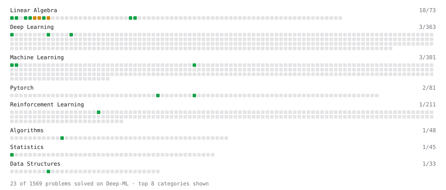

# Deep-ML

My machine learning practice from [Deep-ML](https://www.deep-ml.com). Every solution here was written by hand.

**10** solved · 9 problems · 0 labs · 1 math

[**Browse the interactive portfolio**](https://GregorMilligan.github.io/deep-ml/) to replay this filling in over time.

## Problems

| | Difficulty | Solved | |
| --- | --- | --- | --- |
| [Add Two Numbers as Linked Lists](https://www.deep-ml.com/problems/1086) | easy | 2026-10-12 | [solution](problems/1086-add-two-numbers-as-linked-lists) |
| [Calculate Covariance Matrix](https://www.deep-ml.com/problems/10) | easy | 2026-10-11 | [solution](problems/0010-calculate-covariance-matrix) |
| [Create and Inspect a Tensor](https://www.deep-ml.com/problems/1220) | easy | 2026-10-07 | [solution](problems/1220-create-and-inspect-a-tensor) |
| [Implement Early Stopping Based on Validation Loss](https://www.deep-ml.com/problems/135) | easy | 2026-10-08 | [solution](problems/0135-implement-early-stopping-based-on-validation-loss) |
| [Implement ReLU Activation Function](https://www.deep-ml.com/problems/42) | easy | 2026-10-07 | [solution](problems/0042-implement-relu-activation-function) |
| [KL Divergence Between Two Normal Distributions](https://www.deep-ml.com/problems/56) | easy | 2026-10-11 | [solution](problems/0056-kl-divergence-between-two-normal-distributions) |
| [Linear Regression Using Normal Equation](https://www.deep-ml.com/problems/14) | easy | 2026-10-07 | [solution](problems/0014-linear-regression-using-normal-equation) |
| [Sigmoid Activation Function Understanding](https://www.deep-ml.com/problems/22) | easy | 2026-10-07 | [solution](problems/0022-sigmoid-activation-function-understanding) |
| [Top-K Largest Elements in a List](https://www.deep-ml.com/problems/1137) | easy | 2026-10-12 | [solution](problems/1137-top-k-largest-elements-in-a-list) |

## Math

| | Difficulty | Solved | |
| --- | --- | --- | --- |
| [KL Divergence](https://www.deep-ml.com/math-problems/25) | hard | 2026-10-09 | [solution](math/0025-kl-divergence) |

---

_This file is regenerated by Deep-ML on every push._
